# CamTwisted 🎥

Turn your webcam, your desktop and a pile of silly effects into one virtual camera for your Mac.
Then send it to your calls, a live stream or the telly. 📺

Inspired by CamTwist, a Mac app from the 2000s. CamTwisted is an independent project, written
from scratch. It is not affiliated with or endorsed by the makers or owners of CamTwist.


**In one sentence:** you build a picture out of cameras, screens, videos, text and effects,
and CamTwisted hands it to Zoom, Meet, Teams, a live stream or a TV as if it were a webcam.

## What is in this guide 🗺️

- [Getting set up](#getting-set-up-)
- [The window at a glance](#the-window-at-a-glance-)
- [Building a scene](#building-a-scene-)
- [Three switches that do a lot](#three-switches-that-do-a-lot-)
- [Scenes and going live](#scenes-and-going-live-)
- [Where the picture goes](#where-the-picture-goes-)
- [Sound](#sound-)
- [Saving your work](#saving-your-work-)
- [If you used CamTwist](#if-you-used-camtwist-)
- [Adding your own effects](#adding-your-own-effects-)
- [For the technically minded](#for-the-technically-minded-)
- [Credit where it is due](#credit-where-it-is-due-)

## Getting set up 🚀

Download the newest `CamTwisted` zip from the
[releases page](https://github.com/christianjbrown/camtwisted/releases), unzip it and drag
**CamTwisted** into your Applications folder. (Rather build it? See
[Building it yourself](#building-it-yourself).) After that it is three steps.

1. **Open CamTwisted.** It starts on one scene with your best camera in it. Allow the camera
   when macOS asks.
2. **Install the virtual camera.** Go to the **Output** tab and click **Install camera**.
   macOS then needs you to allow it: open System Settings, go to General, then "Login Items
   & Extensions", scroll down to "By Category", click the (i) beside "Camera Extensions",
   and switch CamTwisted on.
3. **Pick it in your call.** In Zoom, Meet, Teams, FaceTime or anything else, choose
   **CamTwisted Virtual Camera output** as the camera. Whatever is on air in CamTwisted is
   what they see. 🌈

Want sound too? Switch on **Virtual microphone** on the Output tab, click **Install
microphone**, type your Mac's password once, and pick **CamTwisted Virtual Microphone
output** as the microphone in your call.

## The window at a glance 👀

Everything lives in one window.

- **On the left** is the picture that is on air right now, with a **Take snapshot** button.
- **On the right** are two tabs. **Input** is what you are making. **Output** is where it goes.
- Drag the divider between the two halves to give either more room.

On the Input tab you see your **scenes**. A scene is one complete picture: a camera with your
name under it, say, or your slides with you in the corner. One scene is **on air**. The rest
wait their turn.

## Building a scene 🧱

Open a scene (the little arrow beside its name) and you see its **steps**, top to bottom.
Each step is either a **source**, which brings a picture in, or an **effect**, which changes
the picture so far. The order matters: an effect changes everything above it.

### Add a source

Open **Add a source** and click one. Or drag it into the scene exactly where you want it.

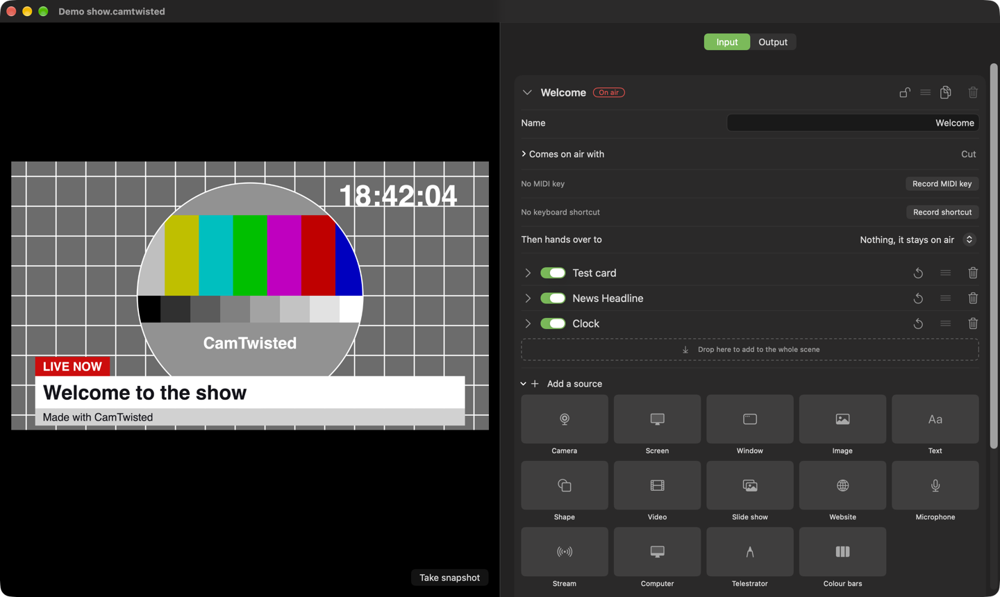

| Source | What it brings in |
| --- | --- |
| Camera | Any webcam. It picks your best one, and you can choose another. |
| Screen | A whole screen, part of one, or the part that follows your mouse. |
| Window | One window, even when other windows cover it. |
| Image | A picture, a logo or a backdrop. |
| Text | A title, a name or a caption, in any font. |
| Shape | A rectangle, circle, triangle, star and more. |
| Video | One clip or a playlist, with captions if you like. |
| Slide show | A set of pictures that changes every few seconds. |
| Website | A live web page. |
| Microphone | Sound only. |
| Stream | A live stream or a video from an address. |
| Computer | Another computer's screen, over VNC. |
| Telestrator | Draw on the picture with your mouse, like a sports pundit. |
| Colour bars | The classic test picture. |

### Add an effect

Open **Add an effect**, just below. Each one has a little preview of what it does, and they
are in alphabetical order. There is a search box if you know what you are after.

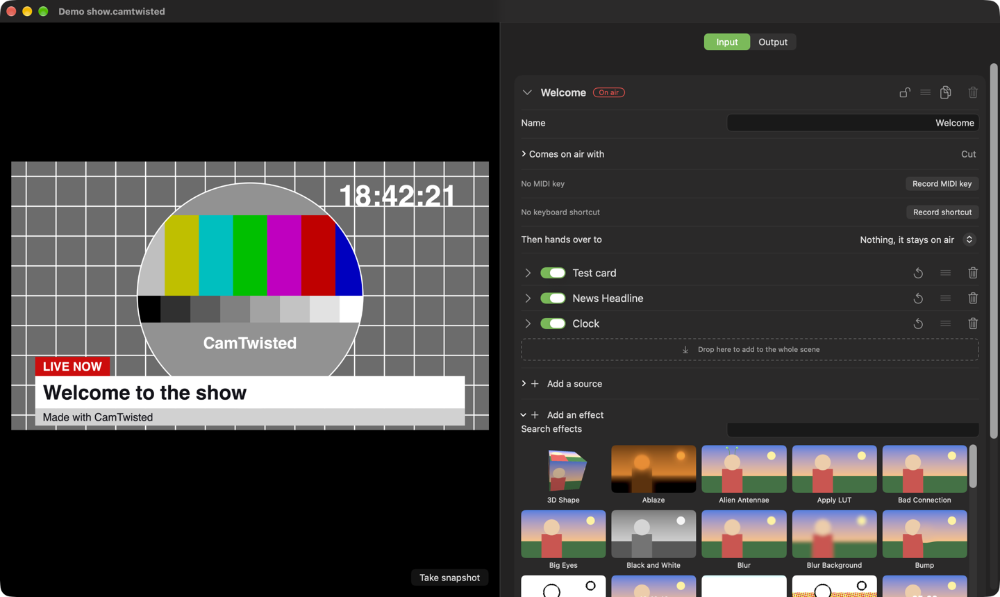

A few favourites:

- **News Headline, Clock, Countdown, Thought bubble** for things written over the picture.
- **Blur Background** to soften whatever is behind you.
- **Toy Figure**, which swaps you for a little plastic figure with a yellow head and a red
  T-shirt. 🧱 Its eyes, brows, nose and mouth copy yours, and its head turns and nods with
  yours. It wants your head and shoulders in the picture, the way you sit for a call.
- **Alien Antennae**, a bobbing pair on top of your head. 👽 They follow whoever is nearest
  the camera.
- **Pixel Sunglasses**, the chunky kind, sat on your eyes. 😎
- **Moustache**, a curly handlebar under your nose, black or any colour you fancy. 🥸
- **Big Eyes**, which makes yours bigger. 👀
- **Follow Me**, which zooms in on you and glides along as you move about, like your own
  camera operator. 🎬
- **Live Captions**, the words said in the sources above it, written along the bottom as
  they are said. Put it under a Microphone and it writes down you; put it under a video and
  it subtitles the video. Each source counts as loud as it is in the mix, so one turned right
  down is left out. Add it with nothing heard above it (your Mac's own camera has no
  microphone of its own) and a Microphone comes along, just above it. Pick the font (Open Sans to start), colour, size and shadow.
  It all happens on your Mac: nothing said goes anywhere. 💬
- **Stop Motion** and **Slow Motion**, for a jerky claymation look or a dreamy replay.
- **Black and White, Sepia, Charcoal sketch, Comic Book, Thermal** and other looks.
- **Crop, Mask, Vignette, Pixelate, Mirror, Kaleidoscope** to reshape the picture.
- **3D Shape** to wrap the picture round a cube or a sphere.
- **Bad Connection**, which freezes you at random so you can blame the wifi. 📶

### Change a step's settings

Click the arrow beside a step to open it. Sliders, colours and text boxes change the picture
as you move them. The circular arrow puts a step's settings back to how they started, and the
bin removes it. The switch turns a step off without losing it.

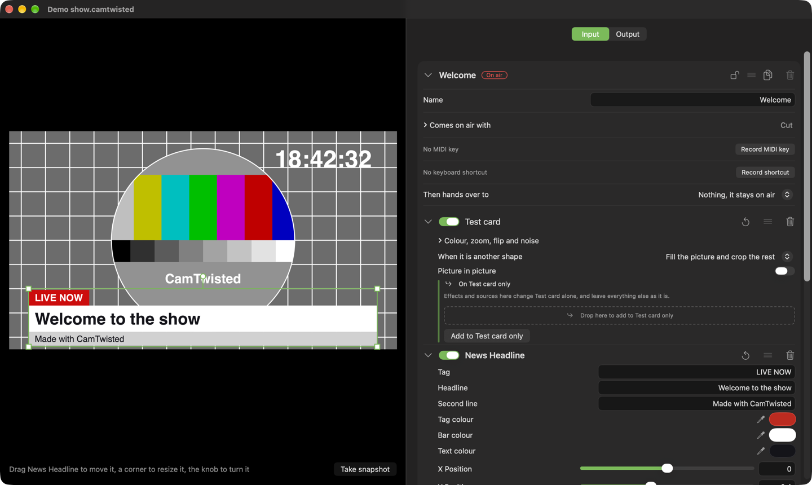

Every source that brings in a picture also has:

- **Remove background and chroma key.** Take away everything but the people, or key out a
  green screen, so what is underneath shows through. No green screen needed for the first.
- **Colour, zoom, flip and noise.** Fix a dull camera without touching anything else.
- **When it is another shape.** A square picture on a wide screen can fill it and lose its
  edges, show all of itself with bars, or stretch.
- **Picture in picture.** Shrink the source and put it anywhere, turned or tilted, and even
  moving on a loop.
- **On this source only.** Steps that belong to this one source. Add an effect here and it
  changes this source alone: blur only the camera, or put a border round the small picture,
  and the rest of the scene is left as it was. Other sources can go here too, such as a logo
  that sits on a screen share and moves with it.

### Move things with your mouse

Click a step and a box appears round it on the picture. Drag the **middle** to move it, a
**corner** to resize it, and the little **knob** on top to turn it. Click outside the box, or
press **Escape**, to let go of it. Press **Delete** to remove the step. This works for pictures
in picture, text, clocks, countdowns, headlines, halos and 3D shapes.

You can also **drag a picture or a video file from Finder straight onto the picture** to add it.

### When something goes missing

If a camera is unplugged, a screen is disconnected or a file has moved, its step and its scene
turn red with a warning mark, so you find out before you go live rather than after. Open the
step and choose again.

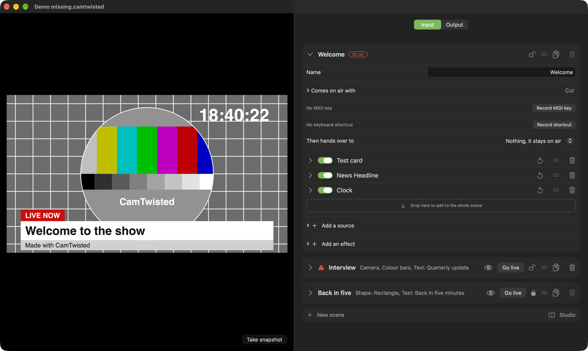

## Three switches that do a lot 🦸

Tucked inside every source are three switches that look modest and are not. Put them
together and one scene can do what used to need a handful of special effects.

### Remove background ✂️

Switch it on and everything that is not a person disappears, so whatever is under that source
shows through instead. No green screen, no lighting rig, no tidying the spare room. It works on a
camera, a video, a still photo, anything with people in it.

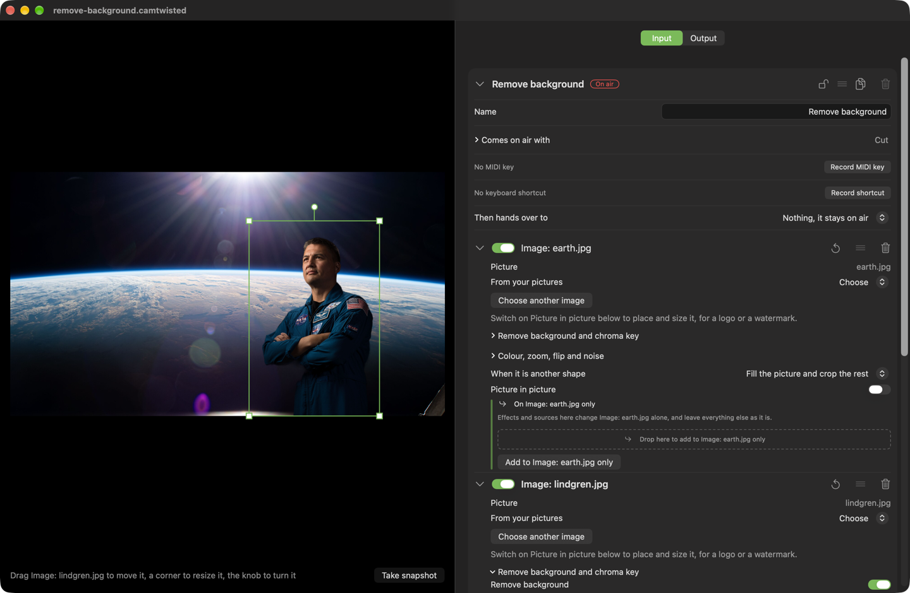

That is a portrait photo with its studio backdrop taken away, sat over a picture of the Earth.
Swap the photo for your camera and the Earth for your slides, and you are presenting from
inside them.

### Chroma key 🟩

Got a real green screen? Chroma key is the sharper tool for it. Pick the **key colour** (or click
the eyedropper and click the screen in the picture), then tune **similarity**, **smoothness** and
**spill reduction** until the edges are clean and nothing on you glows green. It works with any
colour, so a blue sheet is fine too.

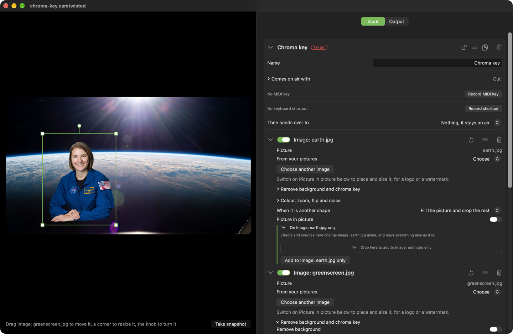

### Picture in picture 🖼️

This is the big one. Any source can be shrunk and put anywhere: dragged with the mouse,
resized from a corner, turned with the knob. Then it gets better. It can **tilt** and **swing**
in three dimensions, as if the picture were a card held at an angle, and it can **move on a
loop** for a bit of life.

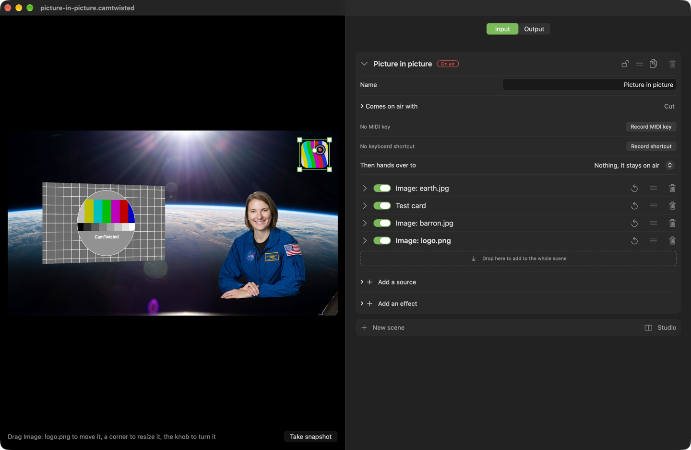

Everything in that picture is just an Image source. The Earth fills the frame. The test card is
in picture in picture, swung round so it hangs at an angle. The astronaut is a photo with
**Remove background** and picture in picture both on. And the little logo in the top corner?
Also an Image, set to picture in picture and made small.

That last one is worth spelling out, because it is how you make an **image overlay**: a logo, a
watermark or a sponsor's badge sat in a corner. Add an **Image**, switch on **Picture in
picture**, and drag it where you want it. A PNG with a see-through background keeps its shape.
No special effect needed, it is just a switch. 🎉

A few more combinations to try:

- **You, floating over a screen share.** A Screen source, then a Camera with remove background
  and picture in picture, tucked in the bottom corner.
- **A news desk.** A backdrop image, you keyed off your green screen, and a video playing in a
  tilted box over your shoulder.
- **A picture frame that moves with the picture.** Put a source inside another one's **On this
  source only** list and it follows its parent wherever it goes.

## Scenes and going live 🎬

- **New scene** at the bottom adds one. Each starts with your camera in it.
- Open a scene that is not on air and it shows in a **preview** while you change it. Nobody
  sees it until you say so.
- **Go live** puts a scene on air. Each scene chooses how it arrives: a plain cut, or a
  transition such as a dissolve or a page curl, under **Comes on air with**.
- The **eye** shows you a folded scene live without opening it.
- The **padlock** locks a scene. A locked scene cannot be changed or removed until you unlock
  it, which is handy for the one you never want to break. The lock is closed on "Back in
  five" below.
- The **two pages** make a copy, the **three lines** drag scenes into a new order, and the
  **bin** removes one (it asks first).
- **Record MIDI key** lets a key on a music keyboard or pad put that scene on air.
- **Record shortcut** gives a scene a keyboard shortcut that puts it on air from **any app**,
  so you can switch scenes without leaving your slides. ⌨️ Press a key with Command, Control or
  Option, or a function key on its own. Escape gives up. A shortcut belongs to one scene, so
  giving it to another takes it from the first.
- **Then hands over to** lets a scene put another on air by itself after so many seconds. ⏱️
  Sponsor slides that rotate, a "starting soon" card that hands over to the show, an intro that
  plays and gets out of the way. Point the last scene back at the first and it goes round and
  round. Putting any scene on air yourself calls the countdown off.

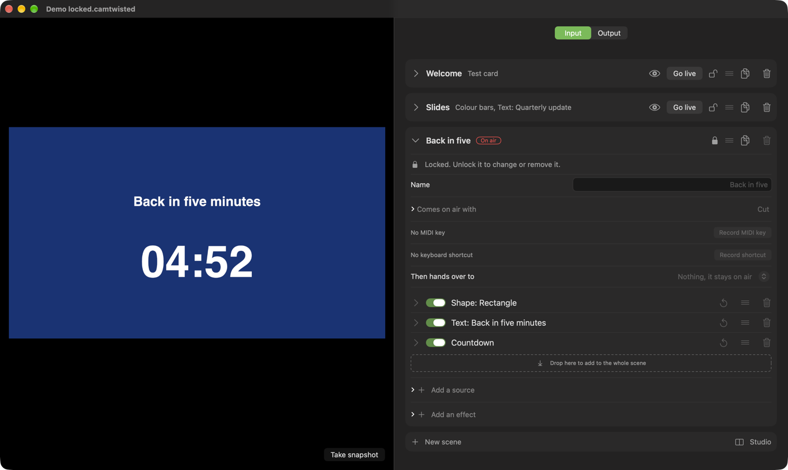

### The studio window

When you are running a show rather than building one, click **Studio** under your scenes (or
pick **Window, Studio**). Once you have two scenes, a little hint there points the way until
you have opened it the first time. It shows what is **on air** beside a **preview**, with
every scene as a tile underneath.

- **Click** a scene to line it up in the preview.
- **Double-click** a scene to put it on air.
- **Go live**, between the two pictures, puts the previewed scene on air, and says under it
  how. Left on **Scene's own** in the panels under **Go live with**, each scene comes on air
  the way it is set up to. Pick another panel, Cut included, and every switch from the studio
  uses that one, for the seconds you set under it. Handy when you are running the show and
  want a dissolve this time and a cut the next, without touching any scene. 🎚️ Double clicks
  use it too.

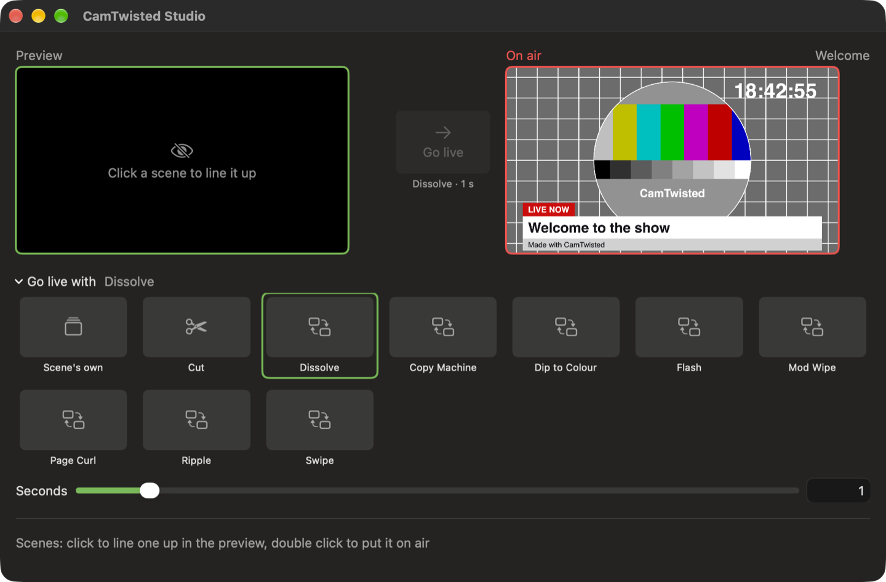

## Where the picture goes 📡

The **Output** tab lists everywhere the picture can go. Each has a switch, and you can turn
on as many as you like. One that is off shows only its switch. Turn it on and its settings appear.

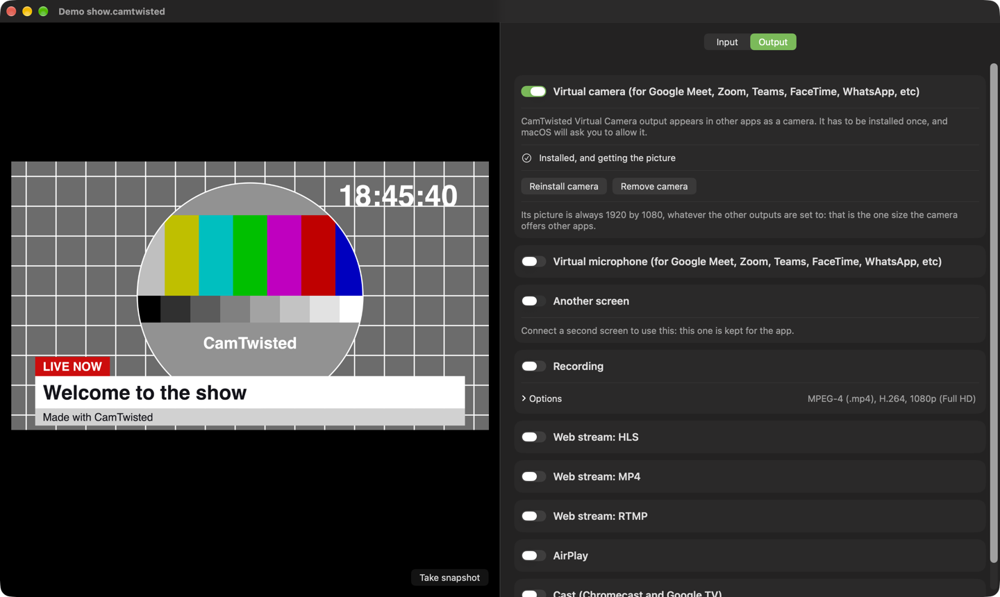

| Output | What it is for |
| --- | --- |
| Virtual camera | Zoom, Meet, Teams, FaceTime and any app that takes a webcam. |
| Virtual microphone | The sound of your scene, as a microphone those same apps can pick. |
| Another screen | Fills a second monitor or a projector. Escape closes it. |
| Recording | Saves a movie, with a chapter for each scene. You pick the folder, the file and the quality. |
| Web stream: HLS | A stream for browsers and players on your network, with a page that plays it. |
| Web stream: MP4 | One endless video, for players that want a plain address. |
| Web stream: RTMP | Sends to a streaming service, such as a live channel. |
| AirPlay | An Apple TV or another AirPlay screen. |
| Cast | A Chromecast or a Google TV. |

**Picture size belongs to each output.** The three web streams and the recording each pick
their own resolution from the same list: 360p, 480p, 540p, 720p, 1080p (Full HD), 1440p and
4K. Nobody has to tell the app how big to draw: it draws in Full HD until something that is
switched on asks for more than 1080p, then in 4K (four times the work for your Mac) for as
long as that lasts. The virtual camera is always 1920 by 1080, the one size its extension
offers, so call apps never notice. 📐

The three web streams each have their own options: the encoding (H.264 plays everywhere,
HEVC is smaller), the resolution, how much data to use, and the sound.

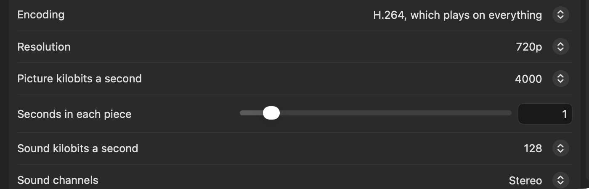

**Recording** keeps its options folded away under its switch, so you can set them before you
start. Unfold **Options** and choose:

- **Folder**: where the movies go. Until you pick one they land with your snapshots.
- **Container**: MPEG-4 (`.mp4`), which it starts on, or QuickTime (`.mov`). Both get the scene chapters.
- **Picture encoding**: H.264, HEVC, or Apple ProRes 422 for editing (ProRes needs a `.mov`).
- **Resolution**: any size from the list above. The picture is scaled to it.
- **Picture kilobits a second**: Automatic gives a bigger picture more data, or pick a figure.
  ProRes takes what it needs, so it has nothing to set.
- **Sound encoding**: AAC, or uncompressed Linear PCM (that one needs a `.mov` too).
- **Sound kilobits a second**: for AAC.

Pick `.mp4` while ProRes or uncompressed sound is chosen and they drop back to H.264 and AAC.
The options lock while a recording is running, so what you see is what that movie gets. 🎬

## Sound 🔊

Sound just follows your scenes. Cameras, microphones, videos, streams, screens and windows
can each make sound, and each has a **Volume** on its step.

- Whatever is in the scene on air is mixed together, each at its own volume.
- The streams and the virtual microphone carry that mix. If nothing in any scene makes
  sound, the streams simply go out silent.
- A **Screen** carries everything your Mac is playing, and a **Window** carries its app's
  sound. Both start at 0%, because on a call they would send everyone's voices straight
  back to them. Turn them up when you mean it.

## Saving your work 💾

CamTwisted always opens as a fresh start. To keep what you have made, save it as a file, the
way you would a document.

- **File, Save** makes a `.camtwisted` file wherever you like. **Double-click it in Finder** and
  CamTwisted opens right where you left off.
- A setup file keeps every scene, the Output tab's settings, and the window's size.
- It never keeps your stream key or your snapshot and recording folders. Those stay on your
  Mac, so a setup file is safe to send to somebody else.
- **File, New** starts again from nothing.
- **File, Open Example Show** opens a ready-made show with three scenes to poke at. It opens
  as a new setup, so saving asks where to keep your copy. 🎬
- Quit with changes you have not saved and CamTwisted asks whether to save them first. No
  changes, no question. 🙌
- Turn on **Save changes automatically** in Settings and every change goes straight into the
  file, so a crash or a power cut loses nothing. It only kicks in once the setup has a file,
  from saving it or opening one.

**Settings** (the CamTwisted menu, or Command-comma) holds the autosave switch and the folder
snapshots are saved to. Recordings go to that folder too, until you give them one of their own
under the Recording switch.

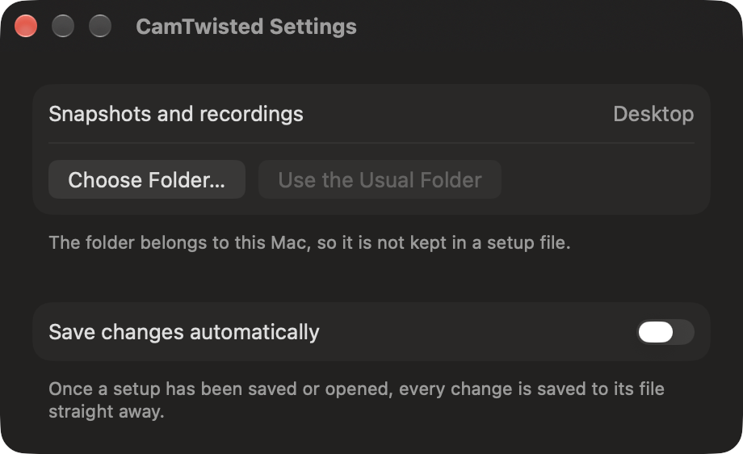

The **Window** menu has two switches for the window itself: **Mirror the Picture**, so you
see yourself the way a mirror shows you, and **Keep on Top**.

## If you used CamTwist 🔁

Welcome! A few things work differently here.

- **Scenes, not columns.** Each scene is a list of sources and effects, top to bottom, and one
  scene is on air at a time.
- **Setups are files.** Save them, open them, double-click them. No named sets inside the app.
- **A proper Camera Extension**, which Zoom, Meet, Teams and FaceTime are happy to load.
- **Effects have their own names**, and live in one alphabetical picker with previews.
- **No Quartz Composer.** `.qtz` effects do not open, but you can bring web page effects of
  your own (see below).
- **Chroma key and background removal** are settings on each source, not effects.

## Adding your own effects 🪄

Every effect and transition in the picker is part of CamTwisted itself, so there is nothing to
download or import. Got effects of your own? Click **Open effects folder** in the picker and
drop your web pages (`.html` files) in. They show up next to the built-in ones.

## For the technically minded 🧰

### Building it yourself

You will need macOS 14 or newer, Xcode, [XcodeGen](https://github.com/yonaskolb/XcodeGen)
(`brew install xcodegen`), and an Apple developer team, because macOS only installs camera
extensions that are signed.

1. Clone the repository.
2. Tell it who you are:

   ```bash
   cp Config/Signing.example.xcconfig Config/Signing.xcconfig
   ```

   Then put your team identifier and a bundle prefix you own in that file. It is gitignored,
   so your details stay on your Mac.

3. Build it and put it in `/Applications`, which macOS insists on for camera extensions:

   ```bash
   tools/install.sh
   ```

### Opening it ready for a job

The window can open on a chosen tab, with the studio window, the picker, the step settings or
Settings already open. Give any of these as defaults or on the command line:

```bash
open -a CamTwisted show.camtwisted --args -OpenOnPane Output -OpenStudioWindow YES
```

The options are `OpenOnPane` (Input or Output), `OpenStudioWindow`, `OpenPicker`,
`ShowEffects`, `OpenStepSettings`, `OpenSettings`, `OpenRecordingOptions`, `SelectStep` (the
number of a step to start selected) and `OpenSetup` (the path of a setup file to open first, so
the others apply to it). They are also how the pictures in this guide were taken.

A few numbers can be turned the same way, with no new build: `SlowMotionFramesPerSecond`,
`SlowMotionLongestLag` (seconds), `SlowMotionWidestFrame` (points), `FaceFramesHeld` (how many
frames a face effect waits for a lost face), `CharacterSmoothing` and `WornSmoothing` (0 to
1), and `RefreshInterval` (seconds between looks for cameras and screens).

The patience and buffer sizes of the plumbing can be turned too. Times are in seconds, and a
value of nought or less is ignored:

- `ScreenRetryDelay`, `RemoteScreenRetryDelay`, `AirPlayRetryDelay` and `CastRetryDelay`: how long
  a screen or window, a Computer source, AirPlay or a Cast device waits before trying again.
- `CastPingInterval`: how often a Cast device is pinged, or it drops us.
- `CameraReconnectInterval`: how often the app looks for the virtual camera while it is missing.
- `CameraSilenceTimeout` and `CameraRetryDelay`: how long the virtual camera lets the app go quiet
  before showing its placeholder, and how long it pauses after an empty answer.
- `MicrophoneLookInterval`: how often the app looks for the virtual microphone.
- `LongestWaitForSound`: how long a web stream waits to hear sound before it starts without.
- `StreamPiecesKept`: how many pieces of a live stream a player can still fetch.
- `StreamChunkSize`, `StreamLargestRead`, `WebLargestRequest`, `RemoteScreenLargestRead` and
  `CastLargestRead`: how many bytes go out or come in at a time (in bytes).
- `SoundTapFrames`: how many frames of sound the mixer takes at a time.
- `FramePoolThreshold`: how many frames the virtual camera lets be in use at once.
- `ThumbnailWarmUp` and `ThumbnailFramesPerSecond`: how long a thumbnail runs, and how fast, before
  its picture is taken.
- `WebsiteSnapshotsPerSecond`: how often a web page is photographed.
- `HotFolderInterval`: how often a watched folder is checked for new videos.
- `RecordingSoundRate`: samples a second in a recording's sound.
- `RecordingBitsPerPixelPerSecond`: how much data a recording's picture gets for each pixel
  when its bit rate is left on Automatic.

`tools/window-shot.sh` does the whole job: it opens the app on a setup with the options you
give and saves a picture of each window. `docs/demo/Demo show.camtwisted` is a setup with no camera in
it, made for exactly that.

### The Mac App Store build

`tools/store-build.sh` makes the build that goes to the App Store and TestFlight, and
`tools/store-build.sh upload` sends it. It differs from the usual build in two ways. It runs in
the App Sandbox, which the store requires, so it remembers the files you choose and saves
snapshots and recordings to Movies unless you pick somewhere else. And it leaves out the
virtual microphone, which the store does not allow inside an app: the Output tab links to
the add-on instead, at the address in `MICROPHONE_ADDON_URL`.

### The download build

`tools/release-build.sh notarise` makes the zip that goes on the releases page: the whole app,
virtual microphone included, signed with a Developer ID and notarised by Apple so it opens
without a fuss. Without `notarise` it stops at the signed app. It is also where the store
build's microphone link leads: install the microphone from this one and the store version
finds it and uses it.

### Scripting it 📜

```applescript
tell application "CamTwisted"
    setSource "Webcam"
    addEffect "Monochrome"
    addEffect "Text"
    setprop effect "Text" property "String" to "back in five"
    click studioButton "Slides"
    studioDissolve
    snapshot
end tell
```

That puts the camera on, adds two effects, sets the text, lines up the scene called Slides,
dissolves to it and takes a snapshot. Effects go by the names you see in the picker.

## Credit where it is due 🙏

**CamTwisted** was made by **Christian Brown**. Found a bug or got an idea? The
[issues page](https://github.com/christianjbrown/camtwisted/issues) is the place. 🛠️

Inspired by CamTwist, a Mac app from the 2000s. CamTwisted is an independent project, written
from scratch. It is not affiliated with or endorsed by the makers or owners of CamTwist.

Thank you to Steve Green, who made CamTwist, for kindly answering an email out of the blue.

The astronaut portraits and the Earth in the pictures in this guide are NASA photographs, which
are in the public domain. 🚀

Live Captions start in Open Sans, by the Open Sans Project Authors, which comes with the app
under the SIL Open Font License (`Resources/Fonts/OFL.txt`). 🔤

## Licence 📄

MIT. See [LICENSE](LICENSE).
